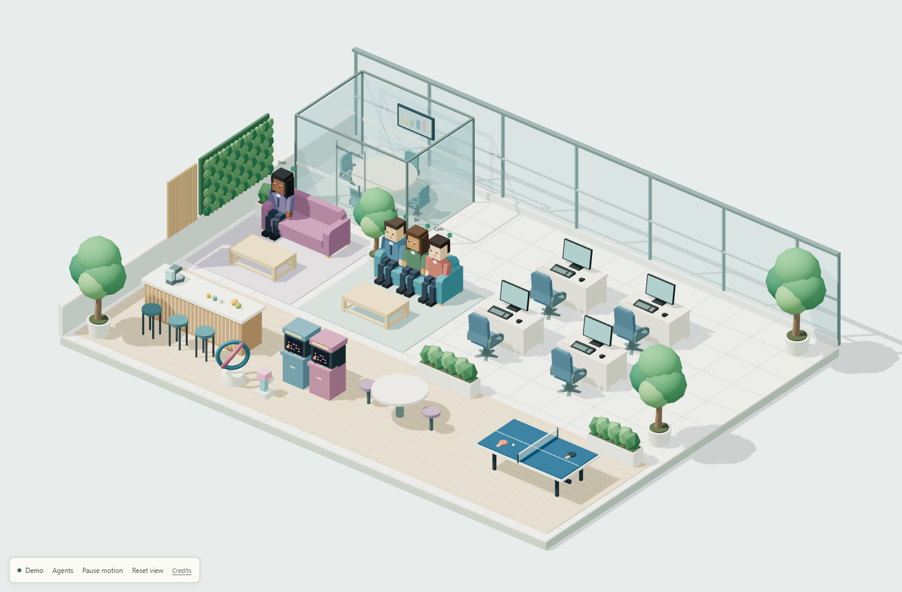
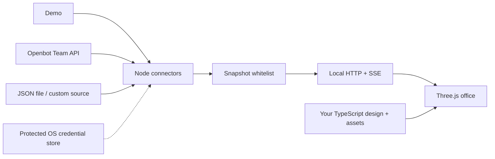

<p align="center"></p>

<h1 align="center">Virtual Office for Nightly Openbot</h1>

<p align="center">A customizable, local 3D office dashboard for Nightly Openbot.</p>

<p align="center">
  <a href="https://github.com/Duy247/agent-office/actions/workflows/ci.yml"></a>
  <a href="LICENSE"></a>
  
  
</p>

<p align="center">
  <a href="#quickstart">Quickstart</a> ·
  <a href="docs/AUTHORING.md">Build your office</a> ·
  <a href="docs/CONNECTORS.md">Connect agents</a> ·
  <a href="CONTRIBUTING.md">Contribute</a>
</p>



_The preview uses simulated agents and activity. No account is required to run it._

OpenBot Virtual Office is a local, read-only 3D dashboard built for [Nightly Openbot](https://github.com/nightly-labs/openbot). It displays your Openbot agents and their live activity through the Team API, while Openbot runs all tasks, conversations and providers. This is an independent community project and is not affiliated with Nightly Labs.

Design the office in TypeScript, create your own assets and place them wherever you want. The included demo and replaceable connectors also let you develop without an Openbot account or adapt the office to other agent systems.

- **Write the office.** Rooms, assets, desks, lights, camera and animation are ordinary TypeScript.
- **Bring your assets.** Build procedural Three.js objects or import local GLB, glTF and OBJ files.
- **Keep live status.** Work, queues, questions, approvals, failures and stale connections appear in the scene. Working bubbles use reported activity, with a plain "Working" fallback when finer detail is unavailable. Separate idle bubbles are decorative cues and make no AI calls.
- **Visit the campus.** Idle agents roam the park, café, arcade and table tennis. Active shared channels bring their members into a conference pod and put the channel name on its screen. See [roaming and meetings](docs/ACTIVITIES.md).
- **View the team.** The sidebar filters working, idle and attention states, shows queued counts and channel members, and opens agent details. Select a character or row, then choose Locate in office to focus the camera. On phones, the panel sits below the office. Use Team to hide or reopen it.
- **Connect Nightly Openbot.** Use its Team API for live status, or start with demo data, a JSON feed or your own adapter.
- **Switch servers.** Choose a saved connection in the sidebar. Each browser keeps its own selection, and each server keeps separate credentials and character assignments. See [server setup](docs/CONNECTORS.md#switch-servers).
- **Grow the room.** Stable desk slots and separate group rooms scale the layout with your roster.
- **Keep it local.** Loopback serving, protected credentials, filtered browser data and clean exports.

## Quickstart

Requires Node.js 24+ and a browser with WebGL 2 graphics acceleration.

```sh
git clone https://github.com/Duy247/agent-office.git
cd agent-office
npm ci
npm start
```

Open **http://127.0.0.1:4318**. A fresh copy uses explicitly labelled **demo** activity, with no accounts or AI providers required. Stop with Ctrl+C. Nothing installs automatic startup or cloud hosting.

Windows shortcuts: Start office.cmd starts a background server and opens the browser; Stop office.cmd stops that background server. Edit office.cmd starts the connector and editing preview. Terminal commands work across platforms; Windows shortcuts are optional conveniences.

## Optional HTTPS reverse proxy

For an optional HTTPS reverse proxy, set `publicOrigin` in `office.config.local.json` to its exact origin, for example `https://office.example.com:10000`. The server still binds to `127.0.0.1` and only accepts the configured hostname and matching browser origin, plus normal loopback access. Configure TLS and routing in your proxy separately. This makes the read-only office, agent names/status and local branding available to whoever can reach that proxy; there is no dashboard login. Omit `publicOrigin` for the default local-only setup.

## Build your own office

1. Keep the connector running.
2. Run `npm run dev` and open **http://127.0.0.1:5173**.
3. Edit **office/office.ts**. Saving design code reloads the preview.
4. Run `npm run build` when you want the normal office to use the new design.

```ts
buildRoom(ctx) {
  buildCampusRoom(ctx); // Remove this to build the room entirely yourself.
  ctx.place('my-tree', 'campus/tree', {
    position: [2, 0, 3], // metres: X, Y height, Z
    rotation: [0, 45, 0], // degrees
    scale: 0.8,
  });
  ctx.box('my-platform', [2, 0.2, 2], '#d3bb93', {position: [2, 0.1, 1]});
}
```

Register procedural Three.js assets or local GLB/glTF/OBJ models in that same file. Put model files in `public/assets/custom/`. Code-created sculpture and imported GLB examples are included. `office/examples/minimal.ts` builds an office without the campus preset. Workstations expose seated anchors so moving or rotating your desk also moves or rotates its agent target.

See [the authoring guide](docs/AUTHORING.md) for custom assets, groups, room layout, lights, animation, walking routes and model import details.

The default scene batches static geometry, sleeps when paused or hidden, and serves compressed assets. See [performance measurements and tuning](docs/PERFORMANCE.md) for results and custom-design controls.

### Boss room

The default design includes a separate executive suite with a local boss character. It uses the final folder name from Windows `USERPROFILE` (or the home directory on other systems) and the male model unless you configure it. The boss is a visual resident, not an Openbot agent: it stays at its desk most of the time, occasionally walks onto the connecting terrace, pauses and returns. It makes no AI calls. Motion pauses when reduced motion is enabled or the source disconnects.

Run `npm run boss` to enter a name and choose `male` or `female`. Or add this to `office.config.local.json`, keeping your existing settings:

```json
{
  "boss": { "name": "Alex", "gender": "female" }
}
```

Restart the office to apply changes. Use `"boss": { "enabled": false }` to omit the suite. Profiles stay local. Edit `office/boss.ts` for the room, fashion models, placement and walking route; the default design calls `withBossRoom`, `buildBossRoom` and `updateBossRoom` so you can replace any part in code. The male model has a dark tailored suit; the female model has a cream blazer, wide-leg trousers and gold accessories. Both retain the office's block-style 3D character design.

### Wall logo

Put your SVG, ICO, PNG, JPEG or WebP logo in `public/assets/local/` (create the folder), then add this to `office.config.local.json`:

```json
{
  "logo": {
    "url": "/assets/local/logo.svg",
    "width": 3.2,
    "height": 1.05
  }
}
```

Run `npm start` again and refresh the office. Each room gets a wall plaque with the image's original proportions. `width` and `height` set the plaque size in metres; optional `position: [x, y, z]` and `rotation: [x, y, z]` (degrees) override placement within each room. Code authors can call `placeWallLogo(ctx, options)` from `office/logo.ts` in their own room designs. Missing images hide the plaque. Local logos and settings are excluded from Git and source exports. For a redistributable logo you own, use `public/assets/custom/` instead. Remote image URLs are not loaded; download your image locally first.

## Connect Nightly Openbot

Adapters are selected in **office.config.local.json**, which is ignored by Git and excluded from source exports:

- **demo**: simulated activity; no source required.
- **openbot**: Nightly Openbot's Team API, with a separate authenticated session, explicit server address or Windows auto-discovery, named credential profiles and capability negotiation.
- **json-file**: another local program writes the normalized agent/group schema.
- **your adapter**: implement `OfficeConnector` and register its factory; no renderer changes required.

Copy and edit office.config.example.json for Openbot, or run the supported sign-in flow:

```sh
npm run connect -- --server http://127.0.0.1:9000 --profile my-server
```

Use your actual Team API address. Windows users may omit --server for local discovery. Explicit HTTPS server addresses are supported; plain HTTP is restricted to loopback. macOS/Linux require explicit server addresses and a working OS credential store. Protected sessions stay outside the project; no plaintext fallback or provider-token reuse is implemented. See [connector setup and adapter examples](docs/CONNECTORS.md).

There is no automatic fallback from a disconnected real source to demo. Stale state preserves the last layout. Agent identity/runtime state comes from the connector; appearance and desk assignments remain local. Optional office.config.local.json settings include characters, deskSlots, group-name overrides and reducedMotion. Detailed 3D placement belongs in office code, not pixel-coordinate settings.

## Source map

| Path                    | Purpose                                                      |
| ----------------------- | ------------------------------------------------------------ |
| `office/office.ts`      | Your design: assets, layout, rooms, desks, camera, animation |
| `office/sdk.ts`         | Typed builder helpers and extension interfaces               |
| `office/assets.ts`      | Local model loading, normalization and independent instances |
| `office/assets/`        | Your code-created assets                                     |
| `office/presets/`       | Editable campus, room and workstation presets                |
| `public/assets/custom/` | Your GLB/glTF/OBJ models and textures                        |
| `src/connectors/`       | Replaceable status adapters                                  |
| `src/shared.ts`         | Connector-neutral snapshot types                             |
| `src/boundary.ts`       | Browser response whitelist                                   |
| `ui/office3d.ts`        | Renderer, selection and live status integration              |
| `ui/characters.ts`      | Shared 3D character/portrait geometry                        |

The included modern preset has glazing, a meeting pod, greenery, cafe furniture, arcade cabinets and table tennis. It grows with the roster, keeps stable desk slots and reserves space for recreation. You can replace all of it.

## Checks and sharing

```sh
npm run format:check
npm run docs:check
npm run typecheck
npm test
npm run build
npm run package
```

Packaging creates **release/agent-office-template.zip**, a clean source copy with dependencies locked and shared demo defaults. It excludes local configuration, credentials, connection-proof output and personal screenshots. Extract it, run npm ci, then npm start. No private server IDs or account details are needed to run the demo. A GitHub Actions workflow is included for Windows/macOS/Linux checks; see VERIFICATION.md for what was actually tested locally.

The optional live HTTP test runs when OFFICE_LIVE_TEST=1 and a connector is serving port 4318. `npm run probe` and `npm run proof` are Openbot diagnostics; their private output is ignored by Git.

Project code is MIT licensed. Kenney furniture retains CC0; Three.js retains MIT. Included licenses and the Credits link cover bundled assets. Use assets you own or are allowed to redistribute when sharing your office.

## Architecture



The scene consumes a connector-neutral snapshot. Authentication, protocol handling and raw payloads remain in the Node adapter. Your design controls geometry and placement; it does not become an agent execution platform.

## Status and compatibility

This is the **0.1.0 preview**. CI checks the source on Windows, macOS and Linux with Node 24. Live Openbot integration has been verified on Windows against Openbot 0.64.0 / protocol 9. macOS/Linux native sign-in still needs live validation. See [verification](VERIFICATION.md), [known limits](CHANGELOG.md#known-limits), and [troubleshooting](docs/TROUBLESHOOTING.md).

## Contributing

Start with [CONTRIBUTING.md](CONTRIBUTING.md). Use demo data for reports and screenshots, and follow the [security policy](SECURITY.md) for sensitive findings. See [third-party notices](THIRD_PARTY_NOTICES.md) for asset provenance and redistribution terms.
