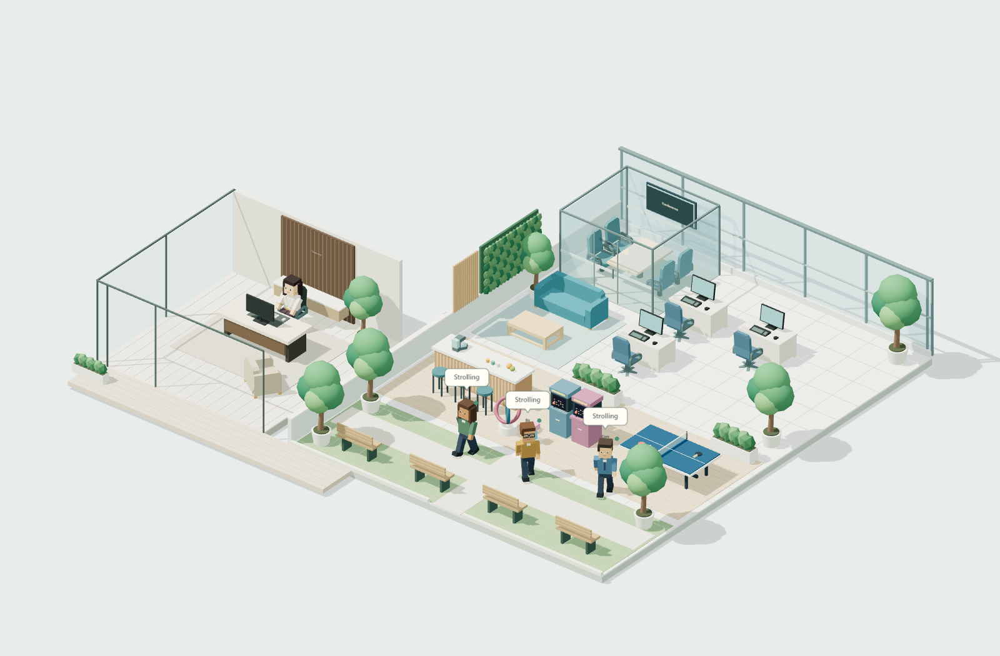
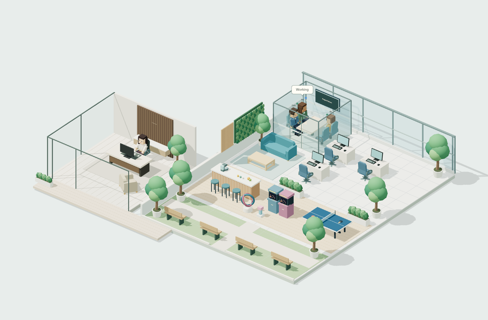

# Roaming, the park and channel meetings

Idle agents occasionally leave their usual lounge seat to visit the café, arcade, table tennis, park paths or park benches. Destinations are reserved so two agents do not claim the same seat. Working or waiting agents do not wander for leisure. New real work interrupts an idle visit immediately.

Green-tinted idle bubbles such as **Strolling**, **Chilling**, **Chatting**, **Whispering**, **Coffee break** and **Playing** are decorative ambient cues. They are not actual conversations, agent reasoning or evidence that an AI provider is running. They make no AI calls. Work bubbles use the source's reported activity and are shown only for the working state. Neither kind appears on a disconnected feed; reduced motion stops idle visits and ambient cues.

## Shared channels

Create a channel with at least two agents in Nightly Openbot and run a task there. When the channel reports open/running work, its members move to a conference room. The screen displays the channel's name. When work finishes, the screen returns to **Conference** and the agents return to their normal work or leisure destinations.

These screenshots use synthetic agents and channel activity. Meeting attendance is a visualization of channel membership and activity, not a change to any agent's source status. An agent can be visibly listening in a meeting while its actual Openbot status remains idle; the detail panel retains that actual status.

The connector optionally negotiates `channel-chats-v1` and `channel-attention-v1`. It reads **GET /v1/channels** for names, membership and work counts, and matches known channel threads to active turns when available. Unrelated direct-agent work does not activate a channel meeting. Channel previews, instructions, messages and thread IDs never enter the browser snapshot. The connector does not read channel transcripts or send any channel commands. Hosts without the channel capability continue with individual desks and leisure behavior.

Each group room provides one conference pod. Concurrent non-overlapping channels can use different available pods; a person attends only one meeting at a time. Ties are resolved by stable channel ID, and additional meetings wait for a suitable room rather than sharing its screen. Pod seating grows to fit known channel membership. Agents from other group rooms use the campus footbridges. Deleted/archived channels and removed members are reconciled with the next source refresh; disconnection preserves the last positions and layout.

## Customize in code

- `office/activities.ts`: destinations, visit timing, ambient labels, seating and meeting priority.
- `office/navigation.ts`: cached floor routing and connecting footbridges.
- `office/presets/park.ts`: grass, paths, trees and benches.
- `office/conference-screen.ts`: channel-name screen styling and wrapping.
- `office/presets/campus.ts`: conference geometry, furniture and entrance.

The default floor grid routes around known furniture and conference walls, with an open conference doorway. Route searches happen on destination changes, not every frame. For a custom office, adjust the obstacle definitions with your furniture or supply your own `route()` hook. Its destination can be `desk`, `lounge`, `leisure` or `meeting`. A custom room without park/conference anchors keeps the basic desk/lounge behavior. Scene animation and visit timers pause while hidden, stale or reduced-motion; asynchronous activity changes still update the display.
